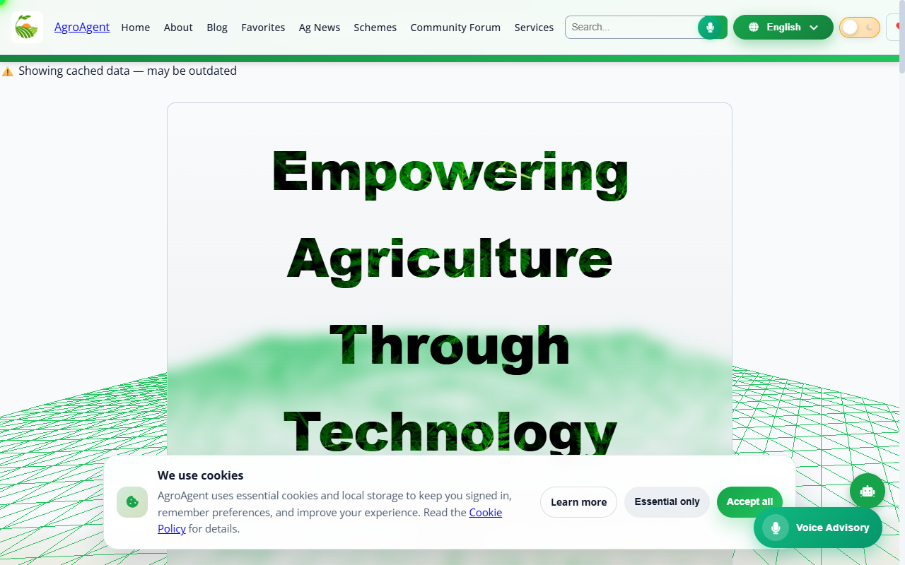
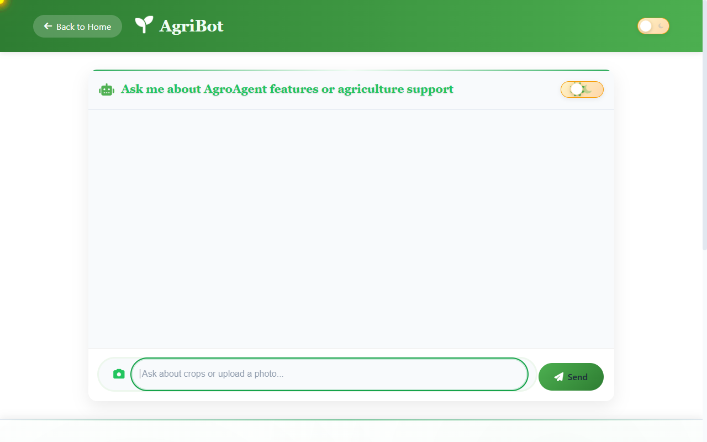
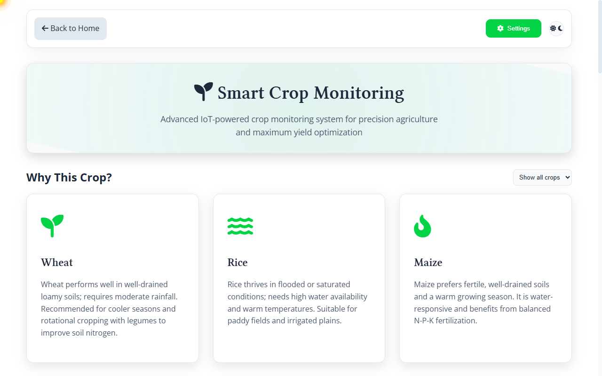
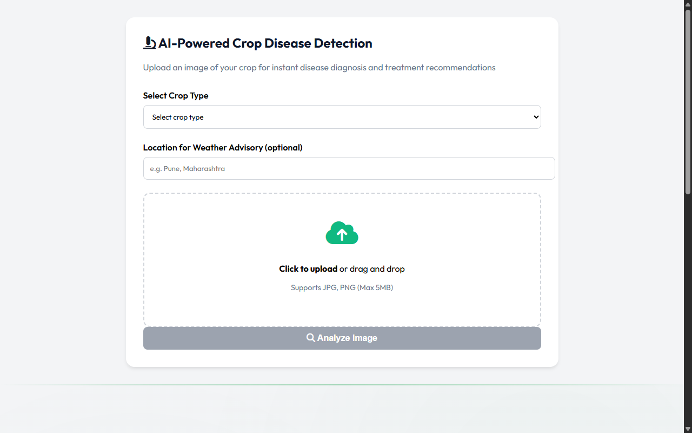
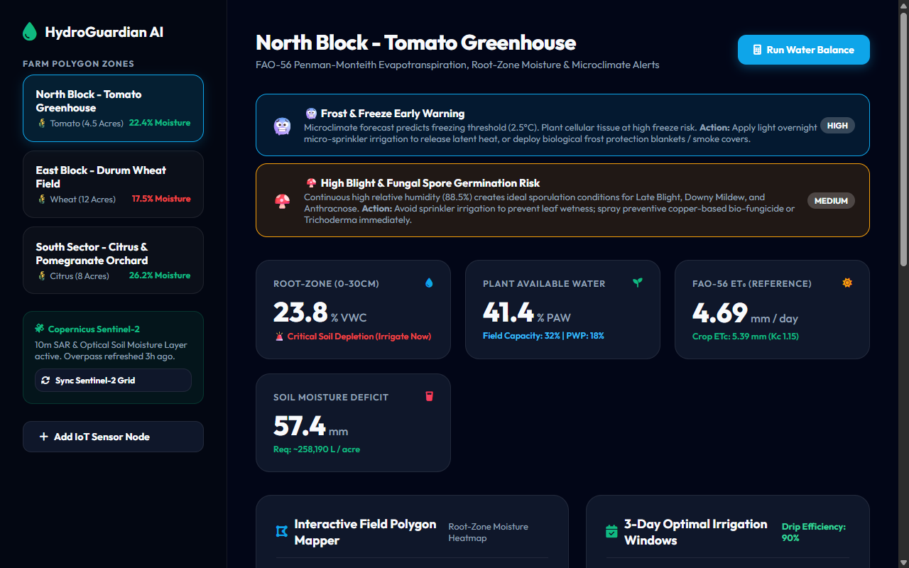
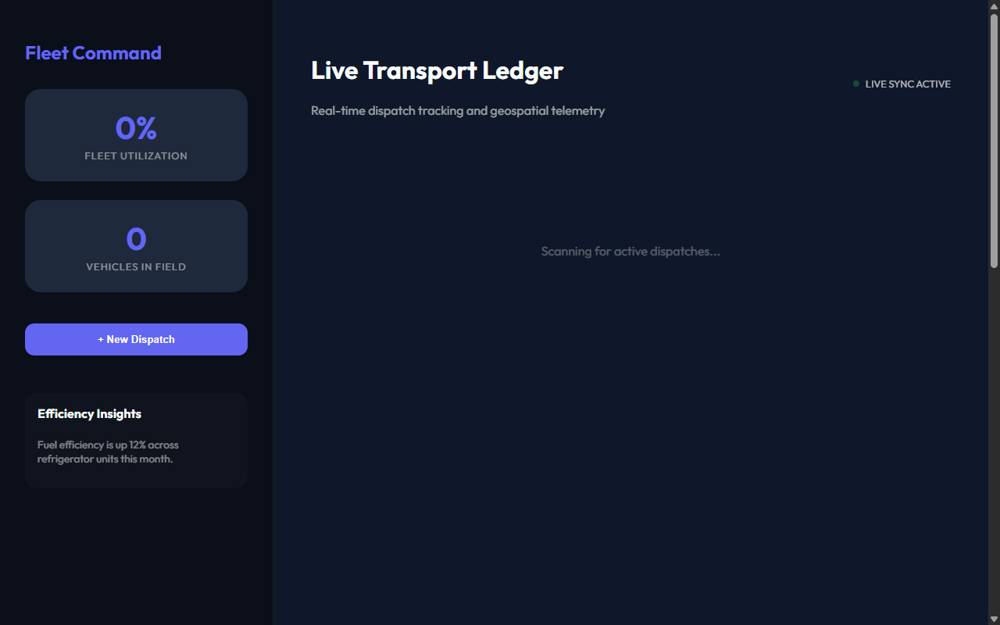
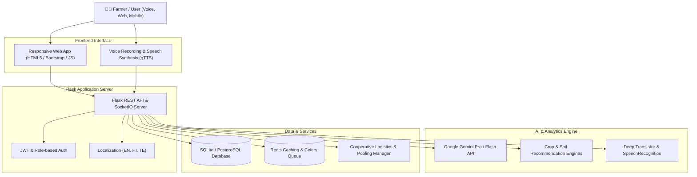

<p align="center">
  
</p>

<h1 align="center">🌱 AgroAgent</h1>

<p align="center">
  <strong>AI-Powered Climate Resilience, Resource Infrastructure & Global Agricultural Supply Ecosystem</strong>
</p>

<p align="center">
  <a href="https://agroagentv1-production.up.railway.app/"></a>
  <a href="https://github.com/abhiraam-hub/agroagent_v1"></a>
  
  
</p>

---

## 📌 Executive Summary

**AgroAgent** is an intelligent, full-stack agricultural ecosystem built for smallholder farmers and agrarian supply networks. Designed for **IDEA FORGE (Track 2: Climate, Resource Infrastructure & Global Supply Resilience)**, AgroAgent combines multimodal Generative AI, machine-learning precision agronomy, voice accessibility across regional Indian languages, and cooperative supply chain pooling to mitigate climate shocks and eliminate post-harvest economic loss.

---

## 📸 Platform Showcase

<p align="center">
  
  <br />
  <em><strong>Figure 1:</strong> AgroAgent Unified Platform Interface — Live weather telemetry, crop advisory navigation, and smart farming tools.</em>
</p>

<br />

<p align="center">
  
  <br />
  <em><strong>Figure 2:</strong> Multimodal & Multilingual Voice AI Advisor — Real-time conversational advisory powered by Google Gemini AI with speech synthesis in English, Hindi, and Telugu.</em>
</p>

<br />

<p align="center">
  
  <br />
  <em><strong>Figure 3:</strong> Precision Crop Recommendation Engine — Tailored crop varieties based on local soil chemistry (NPK, pH), moisture, and climate forecasts.</em>
</p>

<br />

<p align="center">
  
  <br />
  <em><strong>Figure 4:</strong> Plant Pathology & Disease Diagnosis — Automated crop health analysis with instant organic and chemical remediation recommendations.</em>
</p>

<br />

<p align="center">
  
  <br />
  <em><strong>Figure 5:</strong> Climate Resilience & Agro-Weather Dashboard — Micro-climate trend monitoring and real-time precipitation forecasts to guard against extreme weather.</em>
</p>

<br />

<p align="center">
  
  <br />
  <em><strong>Figure 6:</strong> Cooperative Yield Pooling & Logistics Hub — Shared farm equipment booking, freight coordination, and aggregated marketplace distribution.</em>
</p>

---

## ⚡ Key Capabilities

### 🎙️ 1. Multilingual Voice & Multimodal AI Advisory
- Driven by **Google Gemini AI** and **gTTS** (Google Text-to-Speech).
- Full speech and audio synthesis support across **English**, **Hindi (हिंदी)**, and **Telugu (తెలుగు)**.
- Designed specifically for non-literate and regional smallholder farmers to speak queries and receive instant spoken advice on sowing, weather contingencies, and pest control.

### 🌱 2. Precision Crop & Soil Optimization
- Data-driven crop selection models based on soil chemical parameters (**Nitrogen, Phosphorus, Potassium, pH**), temperature, humidity, and forecasted precipitation.
- Prevents over-fertilization, curbs groundwater chemical runoff, and protects topsoil integrity against desertification.

### 🔬 3. Plant Disease Diagnosis & Treatment
- Visual disease scanning with automated identification of plant pathology and fungal/bacterial vectors.
- Instant mitigation recipes including organic remedies, pesticide dosages, and preventative measures.

### 🚜 4. Cooperative Yield Pooling & Logistics Resilience
- Decentralized yield aggregation allows smallholder farmers to combine harvest volumes, gaining institutional bargaining power.
- Shared machinery pooling for heavy infrastructure (tractors, combine harvesters, irrigation pumps).
- Cold-storage transit and route dispatch to minimize post-harvest crop loss.

### 🛡️ 5. Parametric Micro-Insurance & Crisis Alerts
- Real-time climate alerts broadcast over WebSockets and SMS during extreme weather anomalies.
- Frictionless policy registration and digital claim workflow to protect farm families from sudden climate disasters.

---

## 🏗️ System Architecture



---

## 🛠️ Technology Stack

| Layer | Technologies |
| :--- | :--- |
| **Backend Framework** | Python 3.11, Flask 3.1, Flask-SocketIO, Flask-SQLAlchemy, Flask-Migrate |
| **AI & Generative Models**| Google Gemini AI (`google-generativeai`), Scikit-Learn, Joblib |
| **Speech & Audio** | gTTS (Google Text-to-Speech), SpeechRecognition, Deep-Translator |
| **Frontend** | HTML5, CSS3, Modern JavaScript (ES6+), FontAwesome, Bootstrap |
| **Asynchronous & Realtime**| Socket.IO WebSockets, Celery, Redis |
| **Cloud Deployment** | Docker, Railway PaaS, Nixpacks |

---

## 🚀 Getting Started Locally

### 1. Clone the Repository
```bash
git clone https://github.com/abhiraam-hub/agroagent_v1.git
cd agroagent_v1
```

### 2. Create and Activate Virtual Environment
```bash
# Windows
python -m venv .venv
.venv\Scripts\activate

# macOS / Linux
python3 -m venv .venv
source .venv/bin/activate
```

### 3. Install Dependencies
```bash
pip install -r requirements.txt
```

### 4. Configure Environment Variables
Create a `.env` file in the root directory:
```env
PORT=5000
SECRET_KEY=your_secret_key_here
GEMINI_API_KEY=your_gemini_api_key_here
```

### 5. Launch the Application
```bash
python app.py
```
Visit `http://localhost:5000` in your browser.

---

## 🐳 Docker Deployment

Build and run using the production Dockerfile:
```bash
docker build -t agroagent .
docker run -p 5000:5000 -e PORT=5000 agroagent
```

---

## 🌐 Public Live Deployment

The platform is continuously deployed on Railway:
- **Production URL:** [https://agroagentv1-production.up.railway.app](https://agroagentv1-production.up.railway.app)

---

## 👨‍💻 Author & Contact

* **Lead Developer:** Abhiraam Aerukonda
* **GitHub:** [@abhiraam-hub](https://github.com/abhiraam-hub)
* **Email:** [aerukondaabhiraam@gmail.com](mailto:aerukondaabhiraam@gmail.com)
* **Phone:** +91 8985237853
* **Submission for:** IDEA FORGE 2026 — Track 2: Climate, Resource Infrastructure & Global Supply Resilience

---

<p align="center">
  Made with ❤️ for the farming community.
</p>
